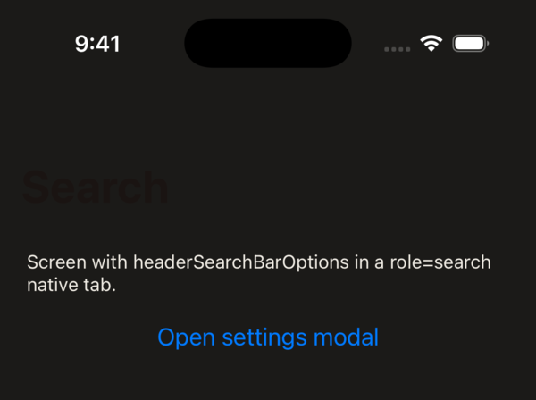

# react-native-screens: large title colour not updated under a modal when a header search bar is active

Minimal reproduction for a react-native-screens iOS bug.

**Versions:** react-native-screens 4.30.1, react-native 0.88.1, Expo SDK 58 (expo-router 58), iOS 26 simulator.

## Steps

1. `npm install`, then `npx expo run:ios`.
2. Open the **Search** tab (the iOS 26 system search tab, `role="search"`). Its stack has a large title and `headerSearchBarOptions`.
3. Tap **Open settings modal**, tap **Switch to dark theme**, tap **Close**.

**Expected:** the large title "Search" uses the new `headerLargeTitleStyle.color` (light text on the dark page).

**Actual:** the title keeps the previous colour (dark text on a dark page) until the screen appears again, for example after switching tabs.



**Control:** the same steps on the **Home** tab, which has no header search bar, update the title correctly.

## Cause

`-[RNSScreenStackHeaderConfig updateViewControllerIfNeeded]` only updates a screen under a modal when that screen's view controller is the presenter:

```objc
BOOL isPresentingVC = nextVC != nil && vc.presentedViewController == nextVC && vc == nav.topViewController;
```

With the header search bar active, the screen is already presenting its `UISearchController`, so UIKit presents the modal from the navigation controller instead. `nav.visibleViewController` is then the modal, `vc.presentedViewController` is the `UISearchController`, and the update is skipped. Nothing re-applies it when the modal is dismissed. Logged values at the moment of the theme switch:

```
vc=RNSScreen nav=RNSNavigationController top=RNSScreen visible=RNSScreen vcPresented=UISearchController navPresented=RNSScreen update=0
```

## Proposed fix

Accept the navigation controller as the presenter too:

```diff
-  BOOL isPresentingVC = nextVC != nil && vc.presentedViewController == nextVC && vc == nav.topViewController;
+  BOOL isPresentingVC = nextVC != nil && vc == nav.topViewController &&
+      (vc.presentedViewController == nextVC || nav.presentedViewController == nextVC);
```

With this change applied as a local patch, the title follows the switch in both directions.
